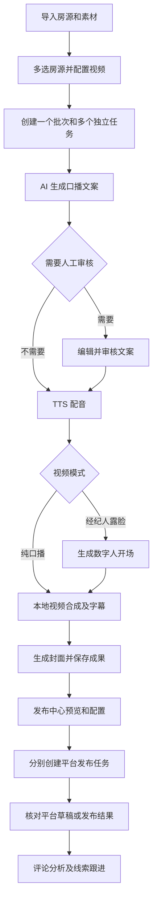

# 产品范围与业务流程

本项目面向房地产经纪人和房产门店，帮助用户把有权使用的房源资料批量制作成营销视频，提交到社交平台草稿或发布流程，并分析评论中的购房需求。

需求来源为[原始讨论](https://chatgpt.com/share/6ae46246-77c0-83ee-878e-337879510e80)。以最后几轮用户确认的交互为准。下文“已确认”属于需求基线；“实现约定”是为了使开发可以执行而补充的设计，允许团队通过评审调整，不能反向覆盖已确认需求。

## 1 产品交付与首版边界

### 1.1 已确认的交付物

| 交付物 | 面向用户 | 核心职责 |
| --- | --- | --- |
| Windows 和 macOS 桌面客户端 | 经纪人 | 房源、视频生产、发布、获客、个人配置 |
| Go 云端服务 | 桌面端与管理后台 | 身份鉴权、业务记录、AI 调用、任务协调、资源目录 |
| Go 本地执行服务 | 桌面客户端内部 | 本地文件、资源安装、视频处理、执行恢复 |
| 平台自动化 Worker | 桌面客户端内部 | 账号连接、已支持的平台操作、结果核对 |
| 独立 Web 管理后台 | 系统管理员 | 用户设备、资源、AI 配置、任务与版本管理 |

用户只需安装一个客户端，不需要自行安装 Go、Node.js、Python、FFmpeg 或浏览器自动化环境。AI 调用、云端同步等能力仍然需要联网。后台管理页面不作为普通用户的另一套业务操作入口。

### 1.2 首版必须实现

- 房源号单条和批量导入，以及文件和人工资料导入入口。
- 纯口播和经纪人露脸两种视频模式。
- 一次多选房源，使用同一套生产配置创建一批独立任务。
- AI 文案、可选审核、TTS、可选数字人开场、视频合成、字幕和封面。
- 成片和完整生产记录查看；抖音、小红书各自的发布配置与执行状态。
- 评论分析、购房意向识别、AI 跟进话术、客户跟进记录。
- 经纪人资料、本人声音和形象、平台账号、默认配置管理。
- 内置资源和云端资源按需下载、版本固定、管理后台发布资源。
- 可恢复的任务记录、失败原因、重试入口、全局任务中心。

“发布到平台草稿”是产品目标，实际按钮根据已验证的平台能力开放。平台不支持可靠草稿保存时，交付本地待发布包并引导用户完成平台操作，不显示虚假的平台成功状态。

### 1.3 首版暂不实现

套餐会员、在线支付、复杂组织权限、专业剪辑时间轴、第三方插件市场、Redis、独立资源商城。保留清晰的鉴权、资源访问和供应商接口即可，不提前建立通用工作流编排器。

积分售卖与扣费已按《16 积分售卖与计费》落地：兑换码 + 后台手动充值，按账号计费，云端在真实调用供应商时扣费；在线支付留待二期接入。

前端 Mock 产品是第一项阶段交付，不能作为真实 AI 生产和真实平台发布已经完成的依据。

## 2 角色与权限

| 角色 | 首版权限 |
| --- | --- |
| 普通用户 | 操作自己的房源、任务、成果、平台账号、声音、形象和线索 |
| 管理员 | 管理用户状态、设备、公共资源、AI 配置、任务诊断、客户端版本 |
| 已登录设备 | 代表当前用户领取允许该设备执行的本地任务，回传执行结果 |

实现约定：首版采用用户级数据隔离，业务记录归属 `owner_user_id`，管理员权限单独校验。用户身份从登录凭证获取，不能接受客户端指定任意记录归属。跨用户对象 ID 必须拒绝访问；管理员查看业务内容需要明确权限并留审计记录。

桌面端必须登录验证身份后才能使用。当前联调采用 SEO-Backend-SDK 邮箱密码认证，由管理员创建账号，关闭公开注册；管理员初始化使用显式命令。真实实现和找回密码等剩余范围见第 06 章。

## 3 核心业务流程

### 3.1 房源进入系统

用户粘贴房源号、上传 Excel 或 CSV，或者补充人工房源资料。系统预检格式、空行、重复号和文件内容，创建导入任务，按房源号展示成功、失败、重复或待补充素材。

同一用户、同一来源、同一房源号不重复创建房源。重新获取资料应产生明确的更新结果，保留已有生产任务中的房源快照，避免历史视频记录随房源修改而变化。缺少关键素材的房源可以进入房源库，但创建视频前必须提示缺项。

贝壳接口或授权获取方式未确定时，使用人工和文件导入完成真实闭环；模拟查询只在 Mock 模式展示。不能从界面设计推断外部平台已经提供接口。

### 3.2 多房源生产

用户选择 N 套房源和一套生成配置，确认后创建一个 `ProductionBatch` 和 N 条 `ProductionTask`。每条任务只对应一套房源，拥有独立文案、音频、成片、封面、审核状态和错误记录。

例如选择 20 套房源，应生成 20 个视频任务。批次只负责分组和汇总，不能把 20 套房源合成一条视频，也不能因为一条失败而取消其他任务。创建前展示准确任务数量；重复点击或网络重发不能重复创建批次。

任务创建时冻结房源和生产配置，包括模板、风格、封面、字幕、声音及形象的引用版本。后续修改用户默认配置或云端模板不改变已有任务。首版不支持在同一批次内为单套房源覆盖配置。

### 3.3 审核与继续执行

开启审核时，文案生成后停在待审核；审核通过当前文案修订后才继续 TTS。关闭审核时按流水线继续。用户可以编辑、保存、重新生成文案或取消任务。

实现约定：已进入下游生产后修改文案，必须使关联的音频、数字人片段、成片和封面文案失效并重新生成；旧成果保留历史引用，但不能再次被当作当前文案对应的有效成片。正在发布的成果版本保持固定，不被后台替换。

### 3.4 发布与发布记录

生产任务成功后出现在发布中心。用户可查看房源、文案、模板与版本、音频、封面、成片和生产过程，再分别配置抖音、小红书的账号、标题、描述、话题和封面。

同一成片可有多条 `PublishTask`。一个平台失败不影响另一个平台。上传完成、平台草稿保存和正式发布是不同结果；只有核对到平台成功发布记录才使房源进入“已发布过”分类。结果未知时进入待确认，不能自动再次提交可能导致重复发布的操作。

### 3.5 AI 获客与跟进

用户选择平台和目标视频，创建评论分析任务。系统提取意向等级、预算、区域、户型和购买时间；没有证据的字段显示未识别，不编造客户画像。用户可查看原始评论、生成并编辑话术、匹配房源、记录跟进和修改状态。

首版以分析和人工跟进辅助为主，不把对陌生评论者批量自动私信纳入默认流程。平台数据可获取范围、联系权限和可执行操作必须由真实接入结果决定。

## 4 关键产品约束

| 约束 | 必须遵守的行为 |
| --- | --- |
| 发布分类 | 只根据确认成功的正式发布记录计算，生成完成和平台草稿不算 |
| 两种视频模式 | 露脸模式额外要求可用形象；切换模式保留房源及通用配置 |
| 资源扩展 | 相同选择入口展示内置、已下载和云端资源；新旧版本可共存 |
| 个人声音和形象 | 分别管理，仅在本人或获得明确授权的素材上创建与使用 |
| 云端与本地 | 云端管理业务资产；平台会话、执行缓存留在用户设备 |
| 演示与正式 | Mock 在页面和执行结果上持续标识，不伪装外部调用成功 |
| 数据更改 | 不覆盖历史任务快照；重生成果产生新修订，发布引用具体修订 |
| 长任务 | 离开页面不停止任务；退出客户端会影响需要本机执行的阶段 |

## 5 在对应阶段前确定的事项

以下事项不阻塞页面和 Mock 开发，但会影响真实能力和正式交付。

| 事项 | 确定时点 | 未确定时的开发方式 |
| --- | --- | --- |
| 产品名称、品牌和视觉素材 | 视觉定稿前 | 使用 KeAgent Studio 作为工作名称 |
| 注册登录方式和管理员初始化 | 真实鉴权接入前 | 使用隔离的演示身份 |
| 贝壳房源获取权限与接口 | 真实房源适配器前 | 人工、CSV 和 Excel 导入 |
| 文案、TTS、声音克隆、数字人供应商 | 对应服务实现前 | 相同接口的 Mock Provider |
| 抖音、小红书草稿和结果核对能力 | 对应平台发布前 | 明确模拟，正式模式提供待发布文件包 |
| 文件留存、注销与删除规则 | 云端存储上线前 | 配置化保留规则，禁止无提示永久删除 |
| 首发系统最低版本、安装包架构 | 打包验收前 | 先验证 Windows x64、macOS x64 和 arm64 的构建链 |
| 视频规格、单批数量与文件大小上限 | 性能验收前 | 服务端返回能力限制，界面进行一致校验 |

产品边界变化需同步修改页面规范、数据契约和验收清单；不能只在某个页面增加一个状态或按钮。
