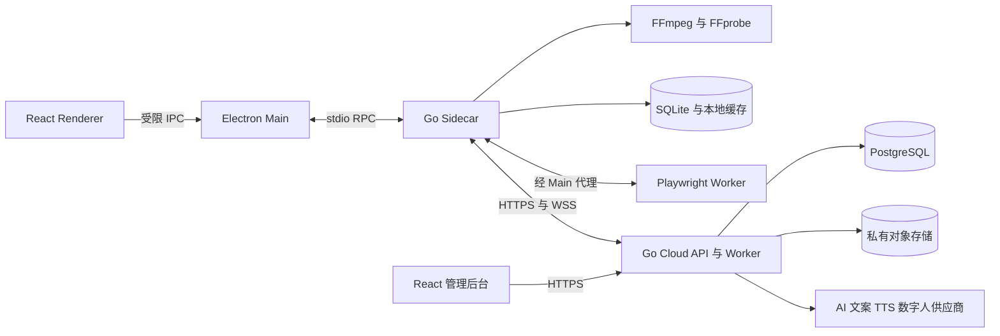

# 系统架构与交付

本章规定客户端、本地执行器、云端和管理后台的职责与交付方式。技术栈及本地执行方向来自已确认需求；进程通信、任务租约、存储策略和部署方式是为实现这些需求补充的设计基线，不代表相关服务已经实现。

## 1. 架构边界

| 层 | 选型 | 负责 | 不负责 |
| --- | --- | --- | --- |
| 桌面界面 | Electron、React、TypeScript | 房源、视频配置、审核、发布和获客交互 | 直接执行系统命令、保存服务商密钥 |
| 桌面主进程 | Electron Main、Preload | 窗口、受限 IPC、原生文件访问、子进程生命周期 | 视频业务调度和云端业务权限判定 |
| 本地执行器 | Go Sidecar、SQLite | 本地任务、素材缓存、资源安装、FFmpeg 调用、云端同步 | 持有云端 AI 供应商密钥 |
| 平台执行进程 | Node Worker、Playwright、Chromium | 本地授权账号操作、平台状态检测与结果核验 | 任意远程脚本执行、无授权平台能力 |
| 云端服务 | Go、Gin、PostgreSQL | 身份、业务记录、AI 网关、任务编排、资源目录、管理 API | 替用户托管本地平台登录会话 |
| 云端文件 | S3 兼容对象存储 | 用户保存资产、云端资源包、安装包、预览文件 | 对公网开放私有资产桶 |
| 管理后台 | React、TypeScript、Ant Design | 用户设备、任务监控、资源及 AI 配置、版本管理 | 作为普通用户的另一套业务操作入口 |

V1 使用单体 Go 服务，按模块组织；API 与后台 Worker 可以通过同一份代码的不同启动模式运行。不拆微服务，不引入 Redis。云端记录按 `owner_user_id` 隔离，管理权限单独校验；组织、门店和复杂多租户权限留待后续。

## 2. 进程与数据流



Renderer 中的云端页面查询可以使用统一 API Client；涉及设备凭据、文件路径和本地执行的请求必须经过 Preload 与 Main。Sidecar 是本地任务的唯一调度者；Main 按其请求代理启动平台 Worker，接收结果并交还 Sidecar，避免两套本地调度并存。

Main 通过 `child_process.spawn` 启动编译后的 Go 二进制，双方使用 stdio RPC；日志写入 stderr，避免污染协议输出。进程启动先握手，报告协议版本、运行时版本及可执行能力；不兼容时停止领取新任务并展示更新提示。Main 退出时管理子进程结束，异常退出由 SQLite 检查点恢复，不依赖退出回调必然执行。

Playwright 使用与其版本配套的浏览器资源，构建时一起准备，不默认复用 Electron 自带 Chromium。[Playwright 浏览器说明](https://playwright.dev/docs/browsers)

### 核心生产链路

1. 用户选择多个房源及一套生成配置；云端事务创建一个批次和 N 个独立生产任务，保存房源与配置快照。
2. 云端执行 AI 文案阶段；需要审核的任务停在审核点，通过后才能继续生成配音与数字人片段。
3. 绑定设备取得本地阶段任务，下载当前任务确实需要的资产及固定版本资源；在本地合成视频、字幕和封面。
4. 本地先落盘、校验输出，再按保存策略上传成果；云端资产登记成功后关联到生产任务。中断上传可以重试，不重新执行已完成的剪辑。
5. 用户在发布中心按平台创建独立发布任务，由指定设备、指定平台账号执行；最终结果必须核验，草稿成功与正式发布成功分别记录。

## 3. 任务调度与恢复

云端以 PostgreSQL 中的任务记录为准。WebSocket 只通知“存在变更”，不能承担唯一任务投递；客户端启动、重连和周期补偿时都能重新查询任务。

云端领取任务使用短事务，候选行通过 `FOR UPDATE SKIP LOCKED` 排除并发领取；领取后立刻提交事务，长任务执行期间不保持数据库行锁。该语法适用于队列式消费，不能替代普通业务查询的一致性要求。[PostgreSQL SELECT 锁定说明](https://www.postgresql.org/docs/current/sql-select.html)

每个执行阶段记录任务 ID、阶段、尝试次数、指定设备、租约到期时间、租约令牌及结果。执行器定期续租，提交结果必须匹配当前租约；旧进程的迟到结果不能覆盖新一轮状态。未获得有效租约时不能开始新的外部副作用。

| 场景 | 处理方式 |
| --- | --- |
| 双击创建、请求超时后重试 | 相同业务请求携带相同幂等键，返回原批次或原发布任务 |
| AI 调用超时 | 先按服务商任务 ID 查询；支持幂等键时复用原键，避免重复付费调用 |
| 本地渲染失败 | 删除本轮临时输出，保留原素材与已完成阶段，只重试失败阶段 |
| 设备断网或关闭 | 云端标记设备离线，本地阶段等待原设备恢复；不擅自迁移平台会话 |
| 租约到期 | 无外部副作用的阶段可重新排队；存在未确认提交的阶段先对账 |
| 平台提交后连接中断 | 进入待确认并核验平台结果；禁止直接再次提交视频 |
| 取消任务 | 停止尚未开始的阶段，并尽力终止正在执行的本地进程；已发生的外部操作保留记录 |

本地 SQLite 保存阶段检查点、文件清单和待同步结果。离线期间不启动新阶段；过期租约不能直接写入完成状态。重连先上报执行证据和检查点供只读核对；云端确认 `productionRevision` 相同、任务未取消且没有新尝试替代后，授予新租约再复用成果，否则仅保留为历史。云端确认结果后再标记同步完成，上报按任务与尝试标识去重。V1 不承诺跨云端和第三方平台的“恰好一次”，通过幂等、结果核验和待确认状态避免重复副作用。

## 4. 数据与文件归属

| 数据 | 权威位置 | 本地策略 |
| --- | --- | --- |
| 用户资料、房源业务信息、文案、任务与发布记录 | PostgreSQL | 缓存用于展示与恢复，冲突以服务端版本规则处理 |
| 用户保存的成片、封面、声音样本和人物资料 | 私有对象存储及资产元数据 | 按任务下载；上传用途与授权在对应流程说明 |
| 平台登录状态与会话 | 用户设备 | 按用户、平台、账号隔离目录；不上传云端 |
| 原始大视频、临时合成文件 | 本地工作目录 | 按需同步，不要求所有原素材默认上传；删除前检查任务引用 |
| 内置字体、模板和执行环境 | 安装资源目录 | 只读，不在安装目录写用户文件 |
| 已下载资源版本、执行检查点和未同步结果 | 本地用户数据目录 | 升级保留，清理必须排除正在引用的文件 |

原始视频可以注册为设备本地 Asset，仅向云端登记元数据、设备 ID 和不透明文件令牌；实际路径由 Sidecar 在本机映射。引用这些素材的任务绑定该设备，执行前验证令牌、文件存在及哈希，不要求先上传原文件。

安装资源通过打包配置放在 ASAR 外，运行时使用 `process.resourcesPath` 定位；electron-builder 中对应 `extraResources`，具体配置层级以项目锁定的版本为准。[electron-builder 资源打包说明](https://www.electron.build/docs/contents/)

用户数据根目录由 `app.getPath('userData')` 获取，在其下区分用户、账号会话、资源版本、工作目录和日志；用户选择的素材源文件不能因为退出或清缓存而被删除。[Electron 路径接口](https://www.electronjs.org/docs/latest/api/app#appgetpathname)

云端资产保存对象键和校验值，不把短期签名 URL 当永久资产地址。下载时鉴权后签发短期地址；未经授权的用户不能通过猜测资产 ID 获取文件。退出登录时撤销令牌、停止新任务并切断当前用户访问；“退出登录”和“删除此用户本地数据”是不同操作。

## 5. 资源管理与更新

资源清单至少包含 ID、类型、版本、文件哈希、大小、兼容模式、最低客户端版本、依赖及授权说明。任务创建后固定资源版本，更新模板不会改变历史任务和已保存成果。

安装流程为：鉴权获取清单及短期地址 → 下载到临时目录 → 校验签名、哈希和大小 → 校验解压路径与依赖 → 原子注册 → 通知 UI 可用。拒绝路径穿越、越界符号链接和超出约定容量的归档；失败时保留上一可用版本。清理资源前检查任务、草稿及历史项目引用。

V1 将更新分为三类：

- 字体、模板、封面和字幕等数据资源：按需下载、版本化安装。
- 提示词、模型路由和功能开关：云端版本配置；客户端缓存经过校验的有效值。
- Go、FFmpeg、Chromium、Playwright 与平台执行代码：随签名客户端更新交付；不通过普通资源包热执行远程代码。

云端资源下架阻止新任务选择，不立刻删除旧任务需要的版本。因安全问题必须禁用时，显示可解释的任务阻断原因。

## 6. 安全基线

Electron 明确开启 `contextIsolation` 和渲染器沙箱、关闭 `nodeIntegration`；Preload 仅导出白名单业务方法，校验 IPC 来源及参数，限制导航和新窗口，不向外部页面暴露桌面权限。采用限制性的 CSP，外部链接校验协议与目标。[Electron 安全建议](https://www.electronjs.org/docs/latest/tutorial/security)

云端 AI、对象存储和签名私钥仅放服务端；桌面短期访问令牌保存在受控内存，刷新凭据使用操作系统保护的存储。平台会话目录限制访问，不进入遥测、备份上传或错误日志。接收文件与 URL 时校验类型、大小和来源；云端拉取外部 URL 需限制网络目标及重定向，防止访问内部地址。

声音与人物形象必须记录本人授权、用途和撤回操作。撤回阻止后续生成，历史已发布内容保留必要的操作记录；云端样本、供应商副本和本地缓存的删除分别执行，界面不能在供应商未确认时显示全部删除完成。

所有用户 API 都验证资源归属，所有管理 API 都验证管理员权限。日志用任务 ID、阶段、设备 ID 和请求 ID 关联，凭据、声音样本原文、完整个人联系方式和私有下载地址脱敏。管理修改、授权变化及发布操作记录审计事件。

## 7. 工程目录

```text
keagent-studio/
  apps/
    desktop/                # main、preload、renderer
    admin/                  # 独立 Web 管理后台
  services/
    cloud/                  # Go API、Worker、迁移与模块
    local-agent/            # Go Sidecar、本地数据库与媒体处理
  workers/
    platform/               # Node 与 Playwright 平台适配
  packages/
    shared-types/           # API、IPC 与事件类型
    api-client/             # 真实接口与 Mock 适配
    resource-schema/        # 资源清单及校验约定
  resources/
    bundled/                # 各目标平台的内置资源与二进制
  docs/
```

UI 组件先在各应用内组织，出现实际重复后再共享。Go 模块和 TypeScript 契约通过 API Schema 约束，不强行共用运行时代码。测试跟随对应业务模块，不提前建立无需求的通用工作流引擎。

## 8. 打包与部署

建议首发 Windows x64、macOS x64、macOS arm64 三套构建，最终目标依产品章待定项确定。每套只放对应架构的 Sidecar、FFmpeg、FFprobe、浏览器及 Worker；运行环境随包分发，用户无需安装开发工具。构建流水线必须在目标系统验证二进制可执行性、字体加载、中文路径、空格路径和权限场景。

macOS 构建完成代码签名及公证，Windows 构建纳入代码签名；证书和签名凭据仅由发布流水线使用。签名与公证属于发布流程，不以本地开发包启动成功代替。[Electron 签名说明](https://www.electronjs.org/docs/latest/tutorial/code-signing)

更新前确认没有需要保护的运行任务，落盘检查点；校验下载包后安装，不覆盖用户数据目录。数据库迁移先备份并验证兼容性；失败时保持可诊断状态，禁止仅回退应用二进制却忽略数据库版本。

云端从一套 Go API、同代码 Worker、PostgreSQL、私有对象存储及静态管理后台部署起步；使用 HTTPS/WSS、受控环境配置、数据库迁移和备份。备份必须验证恢复；资源目录、安装包清单和 AI 配置与应用发布分开管理。上线观察 API 错误、任务积压、失败阶段、设备在线、磁盘不足及供应商异常；不先引入复杂监控平台。

## 9. 开发前需要落定的交付配置

技术设计保持以上基线；实施时补齐 AI 文案、声音克隆、TTS 与数字人供应商，房源授权接入方式，平台支持的草稿能力，字体及媒体分发授权，云区域和用户资产保留策略，签名账号、最低系统版本与资源容量预算。相关能力在沙箱或受控账号实测后才能从 Mock 切换为真实可用。
