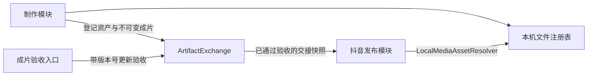

# 成片交接契约 V1

本章是视频制作与抖音发布两个 worktree 的共同基线。只规定成片如何登记、验收、交接和读取，不规定如何生成视频、如何登录抖音或如何执行发布。现有 `ProductionTask`、`PanoramaJob`、`PublishTask` 和 Mock 数据不迁移、不互相转换，也不自动触发这些接口。

## 模块边界



两端只依赖 `packages/shared-types/src/artifact.ts` 的 `ArtifactExchange` 和本机文件解析端口；调用 SDK 为 `packages/api-client/src/artifacts.ts`。发布模块不读取生产任务、全景检查点、房源 Workspace 或制作模块的文件目录。制作模块不创建平台账号或发布任务。

## 数据模型

| 对象              | 含义                                                              | 可变范围                              |
| ----------------- | ----------------------------------------------------------------- | ------------------------------------- |
| `MediaAsset`      | 视频、封面或可选字幕的元数据，以及本机文件令牌                    | 仅 `availability`，使用修订号防止覆盖 |
| `VideoArtifact`   | 一个确定来源版本的成片，引用资产 ID，冻结标题、文案和可选房源摘要 | 仅 `review`，使用修订号防止覆盖       |
| `ArtifactHandoff` | 交接时的成片、验收修订和资产快照                                  | 全部不可变                            |

三个对象都有 `schemaVersion: 1`。服务端生成对象 ID、用户归属和时间；客户端不能填写这些字段。相同用户下，`source.producer + source.taskId + source.revision` 唯一标识一个来源版本。生产任务可以有任意内部结构；来源标识只是追踪信息，不要求存在某张生产任务表。

`content` 只保留交接所需的标题、最终文案和可选房源 ID/标题。完整制作参数和过程保留在制作模块，由来源版本追溯；不通过自由 JSON 扩展混入供应商密钥、平台账号或制作器内部状态。

资产元数据包含类型、MIME、字节数、SHA-256，以及视频/封面的尺寸、视频时长。视频当前只接受 MP4；封面为 JPEG/PNG；字幕为 VTT/SRT。登记只是接收设备报告的元数据，不代表服务端读取或校验了实际文件。此接口不上传文件。

资产位置 V1 只支持 `{kind: "local", deviceId, fileToken}`。设备 ID 来自已认证的设备上下文，令牌为16–128个英文字母、数字、下划线或连字符。拒绝绝对路径、相对路径、HTTP 地址和 `keagent://` 地址。令牌在同一用户、设备内不可绑定到第二个资产；更换文件内容必须登记新令牌和新资产。

V1 不实现跨设备复制、云端文件定位、签名下载、文件注册表或文件解析器。新 worktree 不应通过填一个 URL 绕过这个范围。

## 接口

接口均为认证后的 `POST`，沿用现有 JWT、实时会话及设备校验。客户端正文不传用户 ID 或设备 ID。

| SDK 方法             | HTTP 路径                       | 输入要点                                             |
| -------------------- | ------------------------------- | ---------------------------------------------------- |
| `registerAsset`      | `/v1/media-assets/register`     | `requestKey`、文件令牌和媒体元数据                   |
| `getAsset`           | `/v1/media-assets/get`          | `id`                                                 |
| `reportAvailability` | `/v1/media-assets/availability` | `id`、`expectedRevision`、`available / missing`      |
| `createArtifact`     | `/v1/artifacts/create`          | `requestKey`、来源、内容、视频/封面/可选字幕资产 ID  |
| `getArtifact`        | `/v1/artifacts/get`             | `id`                                                 |
| `listArtifacts`      | `/v1/artifacts/list`            | 可选 `review`、`producer`、`limit`、`offset`         |
| `reviewArtifact`     | `/v1/artifacts/review`          | `id`、`expectedRevision`、`state`、可选 `note`       |
| `createHandoff`      | `/v1/artifact-handoffs/create`  | `requestKey`、`artifactId`、`expectedReviewRevision` |
| `getHandoff`         | `/v1/artifact-handoffs/get`     | `id`                                                 |

`listArtifacts` 返回 `{items,total,limit,offset}`，默认每页20条，最多100条；按创建时间和 ID 倒序。`limit: 0` 也使用默认值。未知字段、非整数修订、非对象正文或超出范围的参数被拒绝。

登记资产、登记成片和创建交接需要已登记的设备上下文；资产可用性只能由文件所属设备报告。V1 成片的所有资产须属于当前用户和同一台操作设备。普通浏览器 SDK 可以鉴权读取和验收，但不附加设备上下文，本机资产写操作会被拒绝。设备上下文用于归属和定位，不代表服务端证明了该设备上的文件真实存在；实际文件仍由本机端口核验。

## 交接顺序与一致性

1. 制作端实际完成文件验证后，在本机注册表建立不透明令牌，再登记视频、封面和可选字幕资产。
2. 制作端调用 `createArtifact`，初始验收为 `pending / revision: 1`。重做生成新来源版本和新成片 ID；不能覆盖旧成片的内容或资产。
3. 验收入口调用 `reviewArtifact`，提交当前验收修订号。每次更新增加修订号；状态可为 `pending / approved / rejected`。两个窗口同时更新时，只允许一个成功。
4. 消费端选择通过验收的成片，调用 `createHandoff`。服务端在同一事务中核对验收修订、资产归属、所属设备和已报告的文件可用性，再持久化快照。
5. 消费端自己的业务记录固定引用交接 ID。后续修改平台标题、话题和封面配置只能进入消费者自己的记录，不能改写交接快照。

`requestKey` 为16–100个英文字母、数字、下划线或连字符，可直接用 `crypto.randomUUID()`。三个创建接口的幂等键分别按用户隔离：同一请求重放返回同一对象；换内容复用旧键返回409。同一来源版本使用新键也不能覆盖已有成片。资产和成片重放可返回当前可用性/验收状态，但内容不变；交接重放始终返回原始完整快照。

**交接快照是历史凭据，不是永久发布许可。** 创建过的快照不会因之后撤回验收或文件丢失而改写；新交接必须重新满足当前条件。消费端在未来真正产生外部副作用前，仍须通过共享接口检查当前验收及资产状态，并在本机验证实际文件；不能把历史快照中的 `available` 当作实时检测。验收修订发生变化时，重新读取并用新请求键交接。

数据库通过用户与资产的复合外键、来源版本唯一约束、行锁、修订号和请求键保证一致性。成片创建、验收及交接写入操作记录。没有删除或覆盖内容的接口。

## 本机文件端口

`LocalMediaAssetResolver.resolve(asset)` 仅在 Main/Worker 内使用，返回 `ResolvedLocalMedia`。其实现由制作 worktree 完成本机资产注册表时提供，发布 worktree 使用注入的端口开发。

端口实现必须核对当前登录用户、当前设备、令牌映射、文件存在、实际字节数和 SHA-256。`absolutePath` 只在本机可信进程内传递，不进入云端、Renderer 或交接 JSON。解析器不能凭接口传来的文件路径直接访问磁盘。云端登记成功但本机映射丢失时，应明确报告文件缺失。

## 错误与客户端

接口错误保持 `{error:{message,code?}}`。SDK 的 `ServiceRequestError` 提供 `status` 和 `code`；浏览器与 Electron 的交接调用一致，业务侧不要解析中文消息。未登录、会话或设备失效沿用现有401/403语义。

| 状态码 / code                          | 消费端处理                                       |
| -------------------------------------- | ------------------------------------------------ |
| 422 `INVALID_INPUT`                    | 修正参数，不原样循环重试                         |
| 404 `NOT_FOUND`                        | 对象不存在或无权读取；不泄露其他用户是否有此对象 |
| 409 `DEVICE_REQUIRED` / `WRONG_DEVICE` | 在已登记且持有文件的设备上操作                   |
| 409 `ASSET_UNAVAILABLE`                | 恢复并重新验证文件，再报告状态                   |
| 409 `REVISION_CONFLICT`                | 刷新验收/可用性修订，重新确认操作                |
| 409 `IDEMPOTENCY_CONFLICT`             | 旧请求键已绑定其他内容，核对原操作               |
| 409 `SOURCE_VERSION_EXISTS`            | 查询原版本，不覆盖；重做应使用新来源版本         |

```ts
import { artifactExchange, ServiceRequestError } from "@keagent/api-client";

const page = await artifactExchange.listArtifacts({ review: "approved" });
// 交接使用选中的成片 ID 和它的 review.revision；不传制作任务对象。
```

Electron 的底层交接 IPC 返回 `{ok,data}` 或 `{ok:false,error}` 以保留错误码，SDK 已解包。两条业务线统一使用 SDK，不直接依赖 IPC 封装格式。现有非交接 IPC 行为保持原样。

## 夹具、检查与当前边界

`packages/shared-types/fixtures/artifact-handoff.v1.json` 是两边共用的静态交接夹具，包含测试用户、测试设备、视频和封面元数据。它不含可播放文件、真实路径、账号授权或平台成功记录，不能当作已生成的视频。需要播放或文件解析测试时，由各自测试适配器显式提供受控的本机测试文件。

SDK 支持 `createArtifactExchange(injectedTransport)`，便于独立测试；正式客户端没有自动 Mock 回退。夹具由 TypeScript 消费端测试及 Go 契约测试共同读取。

```powershell
corepack pnpm lint
corepack pnpm test
corepack pnpm build
node scripts/artifact-exchange-integration.mjs
# 在 services/cloud 运行，ADMIN_TEST_DATABASE_URL 指向可创建临时 schema 的测试数据库
go test ./...
go vet ./...
```

数据库测试使用临时独立 schema 并自动清理，覆盖归属、设备、不可变版本、幂等、验收、文件缺失、并发及 HTTP 错误码。测试不调用生成服务或抖音。本次没有增加成片页面、自动归档生成结果、资产字节上传或抖音执行器。

原生集成检查需要本机服务、`.env.local` 的开发用户和已构建客户端。它验证真实登录、9个固定交接 IPC 路由和错误码透传，只做列表读取及会失败的输入检查，不写入资产或调用外部平台。

两条后续任务分别见 [制作 worktree](worktrees/video-production.md) 与 [抖音发布 worktree](worktrees/douyin-publishing.md)。
